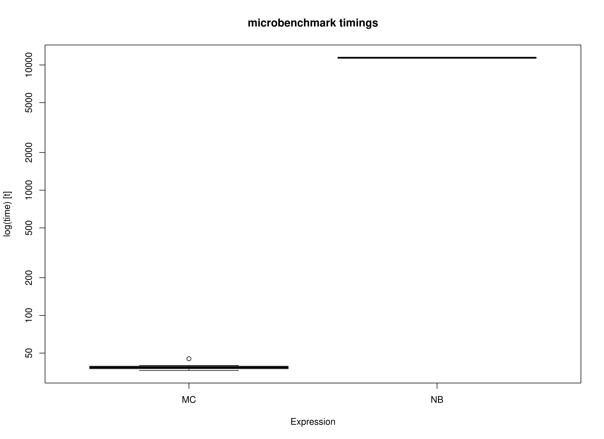
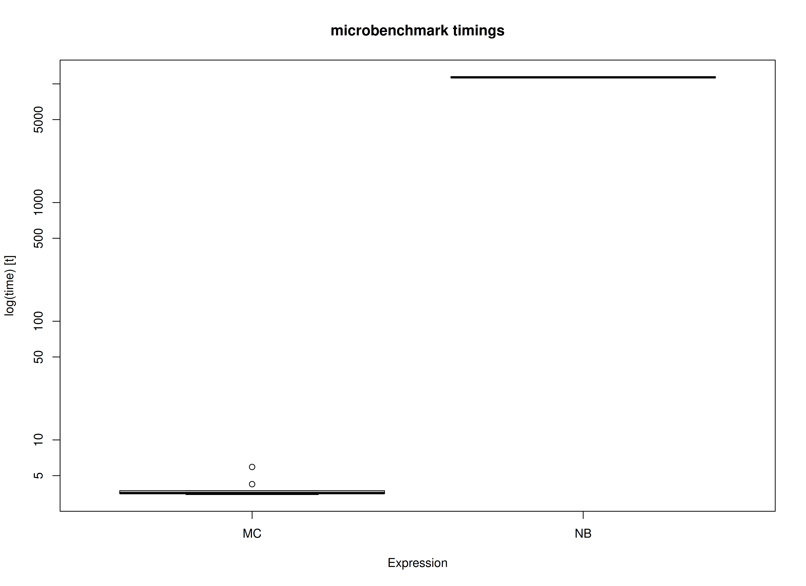

# Benchmark: Comparing the Monte Carlo Method with Nonparametric Bootstrapping (FIML)

We compare the Monte Carlo (MC) method with nonparametric bootstrapping
(NB) using the simple mediation model with missing data using
full-information maximum likelihood. One advantage of MC over NB is
speed. This is because the model is only fitted once in MC whereas it is
fitted many times in NB.

\
[`library`](https://rdrr.io/r/base/library.html)`(``package ``=`` ``semmcci``)`\
[`library`](https://rdrr.io/r/base/library.html)`(``package ``=`` ``lavaan``)`\
[`library`](https://rdrr.io/r/base/library.html)`(``package ``=`` ``microbenchmark``)`

## Data

\
`n`` ``<-`` ``1000`\
`a`` ``<-`` ``0.50`\
`b`` ``<-`` ``0.50`\
`cp`` ``<-`` ``0.25`\
`s2_em`` ``<-`` ``1`` ``-`` ``a``^``2`\
`s2_ey`` ``<-`` ``1`` ``-`` ``cp``^``2`` ``-`` ``a``^``2`` ``*`` ``b``^``2`` ``-`` ``b``^``2`` ``*`` ``s2_em`` ``-`` ``2`` ``*`` ``cp`` ``*`` ``a`` ``*`` ``b`\
`em`` ``<-`` ``stats``::`[`rnorm`](https://rdrr.io/r/stats/Normal.html)`(``n ``=`` ``n``, mean ``=`` ``0``, sd ``=`` `[`sqrt`](https://rdrr.io/r/base/MathFun.html)`(``x ``=`` ``s2_em``)``)`\
`ey`` ``<-`` ``stats``::`[`rnorm`](https://rdrr.io/r/stats/Normal.html)`(``n ``=`` ``n``, mean ``=`` ``0``, sd ``=`` `[`sqrt`](https://rdrr.io/r/base/MathFun.html)`(``x ``=`` ``s2_ey``)``)`\
`X`` ``<-`` ``stats``::`[`rnorm`](https://rdrr.io/r/stats/Normal.html)`(``n ``=`` ``n``)`\
`M`` ``<-`` ``a`` ``*`` ``X`` ``+`` ``em`\
`Y`` ``<-`` ``cp`` ``*`` ``X`` ``+`` ``b`` ``*`` ``M`` ``+`` ``ey`\
`df`` ``<-`` `[`data.frame`](https://rdrr.io/r/base/data.frame.html)`(``X``, ``M``, ``Y``)`\
\
`# Create data set with missing values.`\
\
`miss`` ``<-`` `[`sample`](https://rdrr.io/r/base/sample.html)`(``x ``=`` ``1``:`[`dim`](https://rdrr.io/r/base/dim.html)`(``x ``=`` ``df``)``[``1``]``, size ``=`` ``300``)`\
`df``[``miss``[``1``:``100``]``, ``"X"``]`` ``<-`` ``NA`\
`df``[``miss``[``101``:``200``]``, ``"M"``]`` ``<-`` ``NA`\
`df``[``miss``[``201``:``300``]``, ``"Y"``]`` ``<-`` ``NA`

## Model Specification

The indirect effect is defined by the product of the slopes of paths `X`
to `M` labeled as `a` and `M` to `Y` labeled as `b`. In this example, we
are interested in the confidence intervals of `indirect` defined as the
product of `a` and `b` using the `:=` operator in the `lavaan` model
syntax.

\
`model`` ``<-`` ``"`\
`  Y ~ cp * X + b * M`\
`  M ~ a * X`\
`  X ~~ X`\
`  indirect := a * b`\
`  direct := cp`\
`  total := cp + (a * b)`\
`"`

## Model Fitting

We can now fit the model using the
[`sem()`](https://rdrr.io/pkg/lavaan/man/sem.html) function from
`lavaan`. We are using `missing = "fiml"` to handle missing data in
`lavaan`.

\
`fit`` ``<-`` ``lavaan``::`[`sem`](https://rdrr.io/pkg/lavaan/man/sem.html)`(``data ``=`` ``df``, model ``=`` ``model``)`

## Monte Carlo Confidence Intervals

The `fit` `lavaan` object can then be passed to the
[`MC()`](https://jeksterslab.github.io/semmcci/reference/MC.md) function
from `semmcci` to generate Monte Carlo confidence intervals.

\
[`MC`](https://jeksterslab.github.io/semmcci/reference/MC.md)`(``lav ``=`` ``fit``, R ``=`` ``100L``, alpha ``=`` ``0.05``)`\
`#> Monte Carlo Confidence Intervals`\
`#>             est     se   R   2.5%  97.5%`\
`#> cp       0.2419 0.0305 100 0.1806 0.3004`\
`#> b        0.5166 0.0335 100 0.4513 0.5798`\
`#> a        0.4989 0.0319 100 0.4448 0.5615`\
`#> X~~X     1.0951 0.0621 100 0.9856 1.2026`\
`#> Y~~Y     0.5796 0.0307 100 0.5257 0.6413`\
`#> M~~M     0.8045 0.0464 100 0.6983 0.8764`\
`#> indirect 0.2577 0.0236 100 0.2180 0.3059`\
`#> direct   0.2419 0.0305 100 0.1806 0.3004`\
`#> total    0.4996 0.0333 100 0.4353 0.5569`

## Nonparametric Bootstrap Confidence Intervals

Nonparametric bootstrap confidence intervals can be generated in
`lavaan` using the following.

\
`lavaan``::`[`parameterEstimates`](https://rdrr.io/pkg/lavaan/man/parameterEstimates.html)`(`\
`  object ``=`` ``lavaan``::`[`sem`](https://rdrr.io/pkg/lavaan/man/sem.html)`(`\
`    data ``=`` ``df``,`\
`    model ``=`` ``model``,`\
`    missing ``=`` ``"fiml"``,`\
`    se ``=`` ``"bootstrap"``,`\
`    bootstrap ``=`` ``100L`\
`  ``)`\
`)`\
`#>         lhs op      rhs    label    est    se      z pvalue ci.lower ci.upper`\
`#> 1         Y  ~        X       cp  0.234 0.030  7.721  0.000    0.169    0.287`\
`#> 2         Y  ~        M        b  0.511 0.035 14.704  0.000    0.442    0.585`\
`#> 3         M  ~        X        a  0.481 0.028 17.117  0.000    0.425    0.532`\
`#> 4         X ~~        X           1.059 0.049 21.539  0.000    0.979    1.148`\
`#> 5         Y ~~        Y           0.554 0.029 19.264  0.000    0.490    0.607`\
`#> 6         M ~~        M           0.756 0.032 23.389  0.000    0.693    0.820`\
`#> 7         Y ~1                   -0.013 0.027 -0.473  0.636   -0.065    0.056`\
`#> 8         M ~1                   -0.022 0.030 -0.744  0.457   -0.077    0.044`\
`#> 9         X ~1                    0.002 0.036  0.069  0.945   -0.072    0.074`\
`#> 10 indirect :=      a*b indirect  0.246 0.021 11.534  0.000    0.202    0.286`\
`#> 11   direct :=       cp   direct  0.234 0.030  7.721  0.000    0.169    0.287`\
`#> 12    total := cp+(a*b)    total  0.479 0.030 16.081  0.000    0.417    0.547`

## Benchmark

### Arguments

| Variables | Values | Notes                               |
|:----------|:-------|:------------------------------------|
| R         | 1000   | Number of Monte Carlo replications. |
| B         | 1000   | Number of bootstrap samples.        |

\
`benchmark_fiml_01`` ``<-`` `[`microbenchmark`](https://rdrr.io/pkg/microbenchmark/man/microbenchmark.html)`(`\
`  MC ``=`` ``{`\
`    ``fit`` ``<-`` ``lavaan``::`[`sem`](https://rdrr.io/pkg/lavaan/man/sem.html)`(`\
`      data ``=`` ``df``,`\
`      model ``=`` ``model``,`\
`      missing ``=`` ``"fiml"`\
`    ``)`\
`    `[`MC`](https://jeksterslab.github.io/semmcci/reference/MC.md)`(`\
`      lav ``=`` ``fit``,`\
`      R ``=`` ``R``,`\
`      decomposition ``=`` ``"chol"``,`\
`      pd ``=`` ``FALSE`\
`    ``)`\
`  ``}``,`\
`  NB ``=`` ``lavaan``::`[`sem`](https://rdrr.io/pkg/lavaan/man/sem.html)`(`\
`    data ``=`` ``df``,`\
`    model ``=`` ``model``,`\
`    missing ``=`` ``"fiml"``,`\
`    se ``=`` ``"bootstrap"``,`\
`    bootstrap ``=`` ``B`\
`  ``)``,`\
`  times ``=`` ``10`\
`)`

### Summary of Benchmark Results

\
[`summary`](https://rdrr.io/r/base/summary.html)`(``object ``=`` ``benchmark_fiml_01``, unit ``=`` ``"ms"``)`\
`#>   expr         min          lq        mean      median          uq         max`\
`#> 1   MC    36.30385    37.49956    38.92173    38.39958    39.30792    45.10632`\
`#> 2   NB 11343.45579 11382.61644 11410.14612 11420.09776 11440.48309 11468.21796`\
`#>   neval`\
`#> 1    10`\
`#> 2    10`

### Summary of Benchmark Results Relative to the Faster Method

\
[`summary`](https://rdrr.io/r/base/summary.html)`(``object ``=`` ``benchmark_fiml_01``, unit ``=`` ``"relative"``)`\
`#>   expr      min     lq     mean   median       uq      max neval`\
`#> 1   MC   1.0000   1.00   1.0000   1.0000   1.0000   1.0000    10`\
`#> 2   NB 312.4588 303.54 293.1562 297.4016 291.0478 254.2486    10`

## Plot

## Benchmark - Monte Carlo Method with Precalculated Estimates

\
`fit`` ``<-`` ``lavaan``::`[`sem`](https://rdrr.io/pkg/lavaan/man/sem.html)`(`\
`  data ``=`` ``df``,`\
`  model ``=`` ``model``,`\
`  missing ``=`` ``"fiml"`\
`)`\
`benchmark_fiml_02`` ``<-`` `[`microbenchmark`](https://rdrr.io/pkg/microbenchmark/man/microbenchmark.html)`(`\
`  MC ``=`` `[`MC`](https://jeksterslab.github.io/semmcci/reference/MC.md)`(`\
`    lav ``=`` ``fit``,`\
`    R ``=`` ``R``,`\
`    decomposition ``=`` ``"chol"``,`\
`    pd ``=`` ``FALSE`\
`  ``)``,`\
`  NB ``=`` ``lavaan``::`[`sem`](https://rdrr.io/pkg/lavaan/man/sem.html)`(`\
`    data ``=`` ``df``,`\
`    model ``=`` ``model``,`\
`    missing ``=`` ``"fiml"``,`\
`    se ``=`` ``"bootstrap"``,`\
`    bootstrap ``=`` ``B`\
`  ``)``,`\
`  times ``=`` ``10`\
`)`

### Summary of Benchmark Results

\
[`summary`](https://rdrr.io/r/base/summary.html)`(``object ``=`` ``benchmark_fiml_02``, unit ``=`` ``"ms"``)`\
`#>   expr         min           lq         mean       median           uq`\
`#> 1   MC     3.50444     3.531601     3.883204     3.565345     3.950327`\
`#> 2   NB 11356.31439 11382.002711 11413.286146 11409.877152 11427.619266`\
`#>            max neval`\
`#> 1     5.816675    10`\
`#> 2 11488.896592    10`

### Summary of Benchmark Results Relative to the Faster Method

\
[`summary`](https://rdrr.io/r/base/summary.html)`(``object ``=`` ``benchmark_fiml_02``, unit ``=`` ``"relative"``)`\
`#>   expr     min       lq     mean   median       uq      max neval`\
`#> 1   MC    1.00    1.000    1.000    1.000    1.000    1.000    10`\
`#> 2   NB 3240.55 3222.902 2939.141 3200.217 2892.829 1975.166    10`

## Plot

## References

Pesigan, I. J. A., & Cheung, S. F. (2024). Monte Carlo confidence
intervals for the indirect effect with missing data. *Behavior Research
Methods*, *56*(3), 1678–1696.
<https://doi.org/10.3758/s13428-023-02114-4>
