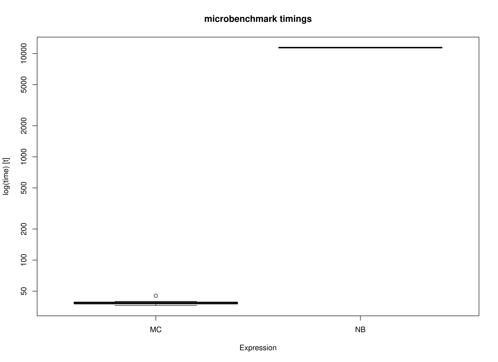
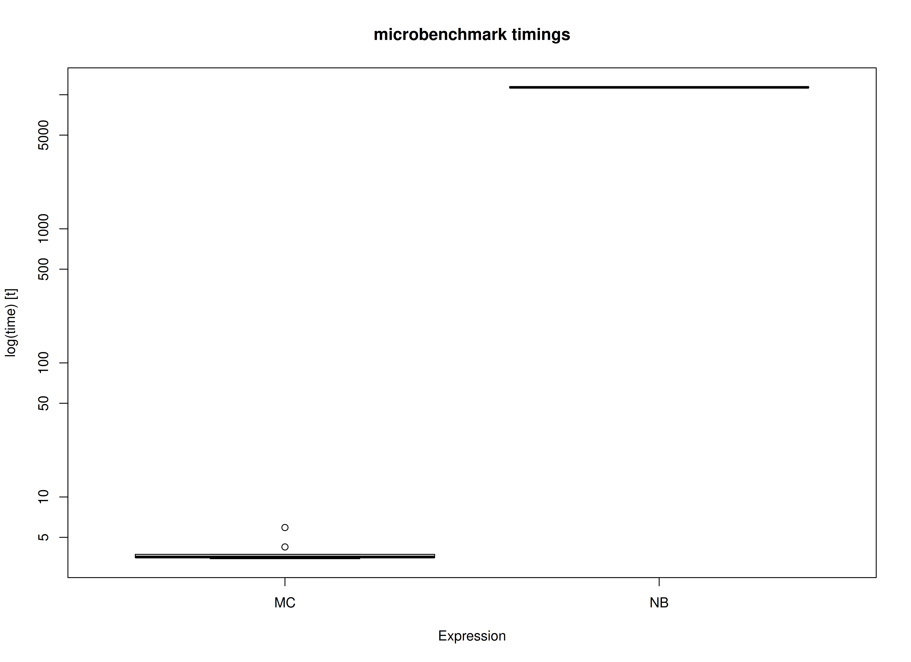

<!-- vignettes/benchmark-complete.Rmd is generated from .setup/vignettes/benchmark-complete.Rmd.orig. Please edit that file -->


We compare the Monte Carlo (MC) method with nonparametric bootstrapping (NB) using the simple mediation model with complete data.
One advantage of MC over NB is speed.
This is because the model is only fitted once in MC whereas it is fitted many times in NB.


``` r
library(package = semmcci)
library(package = lavaan)
library(package = microbenchmark)
```

## Data


``` r
n <- 1000
a <- 0.50
b <- 0.50
cp <- 0.25
s2_em <- 1 - a^2
s2_ey <- 1 - cp^2 - a^2 * b^2 - b^2 * s2_em - 2 * cp * a * b
em <- stats::rnorm(n = n, mean = 0, sd = sqrt(x = s2_em))
ey <- stats::rnorm(n = n, mean = 0, sd = sqrt(x = s2_ey))
X <- stats::rnorm(n = n)
M <- a * X + em
Y <- cp * X + b * M + ey
df <- data.frame(X, M, Y)
```

## Model Specification

The indirect effect is defined by the product of the slopes
of paths `X` to `M` labeled as `a` and `M` to `Y` labeled as `b`.
In this example, we are interested in the confidence intervals of `indirect`
defined as the product of `a` and `b` using the `:=` operator
in the `lavaan` model syntax.


``` r
model <- "
  Y ~ cp * X + b * M
  M ~ a * X
  X ~~ X
  indirect := a * b
  direct := cp
  total := cp + (a * b)
"
```

## Model Fitting

We can now fit the model using the `sem()` function from `lavaan`.


``` r
fit <- lavaan::sem(data = df, model = model)
```

## Monte Carlo Confidence Intervals

The `fit` `lavaan` object can then be passed to the `MC()` function from `semmcci`
to generate Monte Carlo confidence intervals.


``` r
MC(lav = fit, R = 100L, alpha = 0.05)
#> Monte Carlo Confidence Intervals
#>             est     se   R   2.5%  97.5%
#> cp       0.2333 0.0296 100 0.1806 0.2903
#> b        0.5082 0.0279 100 0.4555 0.5527
#> a        0.4820 0.0280 100 0.4220 0.5301
#> X~~X     1.0590 0.0426 100 0.9883 1.1428
#> Y~~Y     0.5462 0.0231 100 0.5064 0.5959
#> M~~M     0.7527 0.0337 100 0.6846 0.8029
#> indirect 0.2449 0.0179 100 0.2058 0.2738
#> direct   0.2333 0.0296 100 0.1806 0.2903
#> total    0.4782 0.0295 100 0.4162 0.5283
```

## Nonparametric Bootstrap Confidence Intervals

Nonparametric bootstrap confidence intervals can be generated in `lavaan` using the following.


``` r
lavaan::parameterEstimates(
  object = lavaan::sem(
    data = df,
    model = model,
    se = "bootstrap",
    bootstrap = 100L
  )
)
#>        lhs op      rhs    label   est    se      z pvalue ci.lower ci.upper
#> 1        Y  ~        X       cp 0.233 0.025  9.395      0    0.183    0.278
#> 2        Y  ~        M        b 0.508 0.028 18.057      0    0.454    0.568
#> 3        M  ~        X        a 0.482 0.026 18.550      0    0.433    0.535
#> 4        X ~~        X          1.059 0.046 23.224      0    0.969    1.161
#> 5        Y ~~        Y          0.546 0.023 23.640      0    0.508    0.593
#> 6        M ~~        M          0.753 0.033 23.131      0    0.692    0.814
#> 7 indirect :=      a*b indirect 0.245 0.020 12.443      0    0.209    0.289
#> 8   direct :=       cp   direct 0.233 0.025  9.395      0    0.183    0.278
#> 9    total := cp+(a*b)    total 0.478 0.027 17.966      0    0.418    0.518
```

## Benchmark

### Arguments


|Variables |Values |Notes                               |
|:---------|:------|:-----------------------------------|
|R         |1000   |Number of Monte Carlo replications. |
|B         |1000   |Number of bootstrap samples.        |


``` r
benchmark_complete_01 <- microbenchmark(
  MC = {
    fit <- lavaan::sem(
      data = df,
      model = model
    )
    MC(
      lav = fit,
      R = R,
      decomposition = "chol",
      pd = FALSE
    )
  },
  NB = lavaan::sem(
    data = df,
    model = model,
    se = "bootstrap",
    bootstrap = B
  ),
  times = 10
)
```

### Summary of Benchmark Results


``` r
summary(object = benchmark_complete_01, unit = "ms")
#>   expr        min         lq       mean     median         uq        max neval
#> 1   MC   22.88751   23.29013   24.77872   23.63868   24.90285   33.35495    10
#> 2   NB 5366.36058 5434.68588 5469.37173 5475.40795 5487.12449 5578.83127    10
```

### Summary of Benchmark Results Relative to the Faster Method


``` r
summary(object = benchmark_complete_01, unit = "relative")
#>   expr      min       lq     mean   median       uq      max neval
#> 1   MC   1.0000   1.0000   1.0000   1.0000   1.0000   1.0000    10
#> 2   NB 234.4668 233.3472 220.7286 231.6292 220.3412 167.2565    10
```

## Plot



## Benchmark - Monte Carlo Method with Precalculated Estimates


``` r
fit <- lavaan::sem(
  data = df,
  model = model
)
benchmark_complete_02 <- microbenchmark(
  MC = MC(
    lav = fit,
    R = R,
    decomposition = "chol",
    pd = FALSE
  ),
  NB = lavaan::sem(
    data = df,
    model = model,
    se = "bootstrap",
    bootstrap = B
  ),
  times = 10
)
```

### Summary of Benchmark Results


``` r
summary(object = benchmark_complete_02, unit = "ms")
#>   expr         min          lq        mean     median          uq         max
#> 1   MC    3.452824    3.539666    3.823525    3.58416    3.660413    5.482228
#> 2   NB 5268.129761 5287.421831 5306.089146 5307.07607 5329.313722 5340.187129
#>   neval
#> 1    10
#> 2    10
```

### Summary of Benchmark Results Relative to the Faster Method


``` r
summary(object = benchmark_complete_02, unit = "relative")
#>   expr      min       lq     mean   median       uq      max neval
#> 1   MC    1.000    1.000    1.000    1.000    1.000   1.0000    10
#> 2   NB 1525.745 1493.763 1387.748 1480.703 1455.932 974.0907    10
```

## Plot



## References
