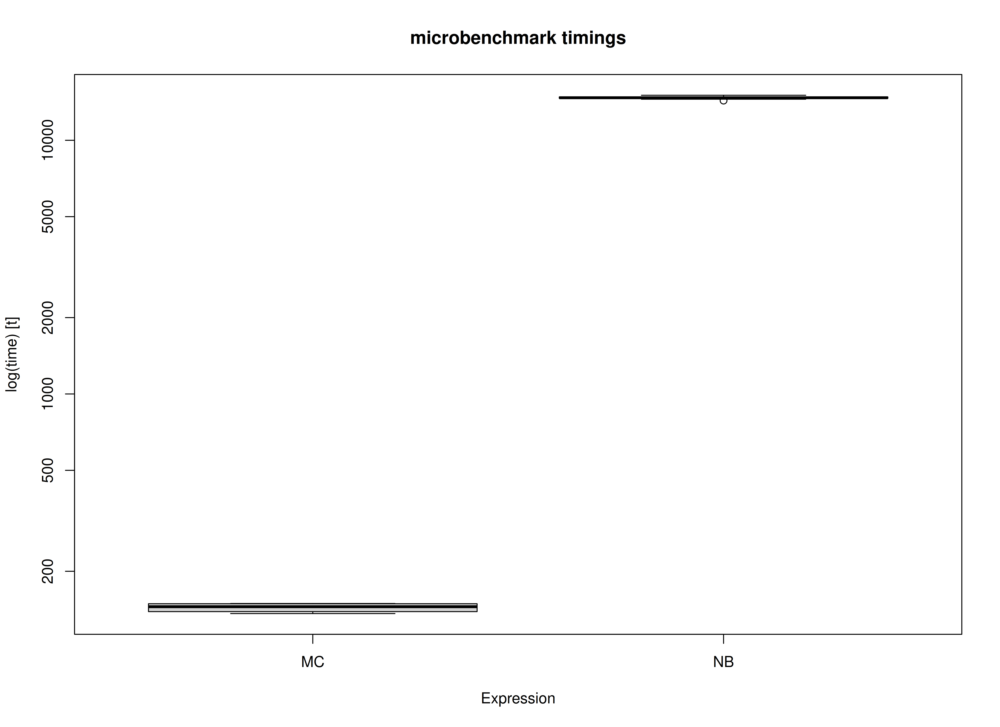
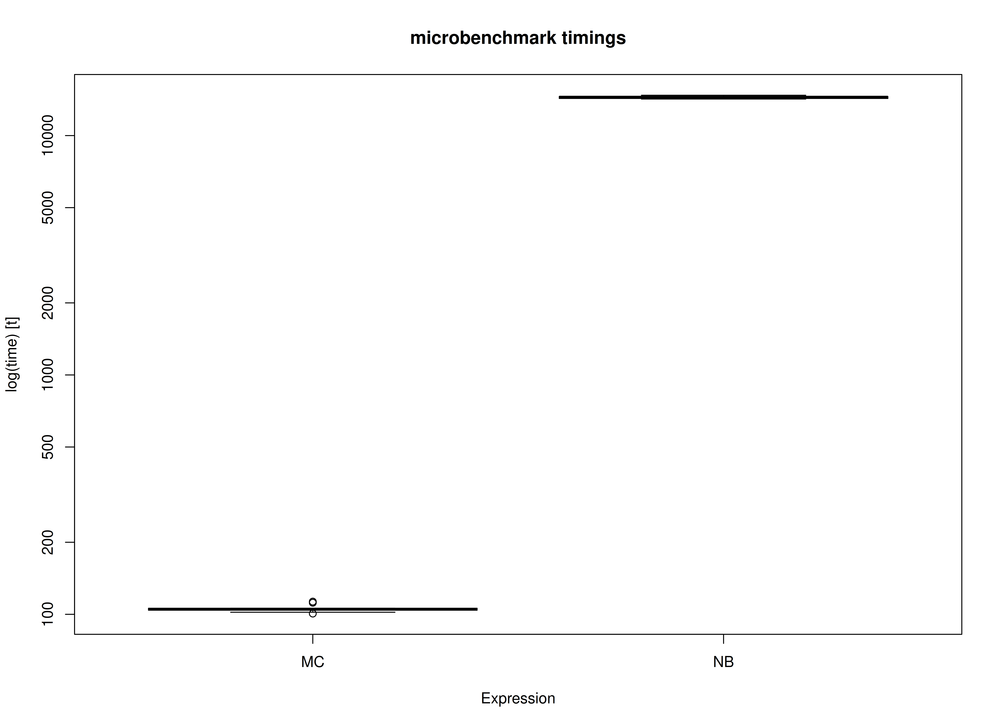

<!-- vignettes/benchmark-mi.Rmd is generated from .setup/vignettes/benchmark-mi.Rmd.orig. Please edit that file -->


We compare the Monte Carlo (MC) method with nonparametric bootstrapping (NB) using the simple mediation model with missing data
using multiple imputation.
One advantage of MC over NB is speed.
This is because the model is only fitted once in MC whereas it is fitted many times in NB.


``` r
library(package = semmcci)
library(package = lavaan)
library(package = Amelia)
library(package = microbenchmark)
```

## Data


``` r
n <- 1000
a <- 0.50
b <- 0.50
cp <- 0.25
s2_em <- 1 - a^2
s2_ey <- 1 - cp^2 - a^2 * b^2 - b^2 * s2_em - 2 * cp * a * b
em <- stats::rnorm(n = n, mean = 0, sd = sqrt(x = s2_em))
ey <- stats::rnorm(n = n, mean = 0, sd = sqrt(x = s2_ey))
X <- stats::rnorm(n = n)
M <- a * X + em
Y <- cp * X + b * M + ey
df <- data.frame(X, M, Y)

# Create data set with missing values.

miss <- sample(x = 1:dim(x = df)[1], size = 300)
df[miss[1:100], "X"] <- NA
df[miss[101:200], "M"] <- NA
df[miss[201:300], "Y"] <- NA
```

## Multiple Imputation

Perform the appropriate multiple imputation approach to deal with missing values.
In this example, we impute multivariate missing data under the normal model.


``` r
mi <- Amelia::amelia(
  x = df,
  m = 5L,
  p2s = 0
)
```

## Model Specification

The indirect effect is defined by the product of the slopes
of paths `X` to `M` labeled as `a` and `M` to `Y` labeled as `b`.
In this example, we are interested in the confidence intervals of `indirect`
defined as the product of `a` and `b` using the `:=` operator
in the `lavaan` model syntax.


``` r
model <- "
  Y ~ cp * X + b * M
  M ~ a * X
  X ~~ X
  indirect := a * b
  direct := cp
  total := cp + (a * b)
"
```

## Model Fitting

We can now fit the model using the `sem()` function from `lavaan`.
We do not need to deal with missing values in this stage.


``` r
fit <- lavaan::sem(data = df, model = model)
```

## Monte Carlo Confidence Intervals (Multiple Imputation)

The `fit` `lavaan` object and `mi` `mids` object can then be passed to the `MCMI()` function from `semmcci`
to generate Monte Carlo confidence intervals
using multiple imputation
as described in Pesigan and Cheung (2024).


``` r
MCMI(lav = fit, R = 100L, alpha = 0.05, mi = mi)
#> Monte Carlo Confidence Intervals (Multiple Imputation Estimates)
#>             est     se   R   2.5%  97.5%
#> cp       0.2274 0.0318 100 0.1685 0.2901
#> b        0.5192 0.0325 100 0.4584 0.5710
#> a        0.4790 0.0280 100 0.4283 0.5272
#> X~~X     1.0613 0.0443 100 0.9775 1.1327
#> Y~~Y     0.5439 0.0244 100 0.4999 0.5916
#> M~~M     0.7642 0.0394 100 0.7037 0.8392
#> indirect 0.2486 0.0176 100 0.2153 0.2762
#> direct   0.2274 0.0318 100 0.1685 0.2901
#> total    0.4760 0.0297 100 0.4284 0.5437
```

## Nonparametric Bootstrap Confidence Intervals (Multiple Imputation)

Nonparametric bootstrap confidence intervals can be generated in `bmemLavaan` using the following.


``` r
summary(
  object = bmemLavaan::bmem(data = df, model = model, method = "mi", boot = 100L, m = 5L)
)
#> 
#> Estimate method:                          multiple imputation
#> Sample size:                              1000      
#> Number of request bootstrap draws:        100       
#> Number of successful bootstrap draws:     100       
#> Type of confidence interval:              perc
#> 
#> Values of statistics:
#> 
#>                      Value      SE      2.5%     97.5%
#>   chisq               0.000    0.000    0.000    0.000   
#>   GFI                 1.000    0.000    1.000    1.000   
#>   AGFI                NA       NA       NA       NA      
#>   RMSEA               0.000    0.000    0.000    0.000   
#>   NFI                 1.000    0.000    1.000    1.000   
#>   NNFI                1.000    0.000    1.000    1.000   
#>   CFI                 1.000    0.000    1.000    1.000   
#>   BIC                 7742.967 81.777   7575.258 7857.675
#>   SRMR                0.000    0.000    0.000    0.000   
#> 
#> Estimation of parameters:
#> 
#>                      Estimate   SE      2.5%     97.5%
#> Regressions:
#>   Y ~
#>     X        (cp)     0.234    0.030    0.176    0.296
#>     M         (b)     0.513    0.032    0.460    0.570
#>   M ~
#>     X         (a)     0.476    0.030    0.426    0.540
#> 
#> Variances:
#>     X                 1.057    0.046    0.950    1.144
#>     Y                 0.556    0.027    0.488    0.600
#>     M                 0.755    0.035    0.684    0.813
#> 
#> 
#> 
#> Defined parameters:
#>     a*b    (indr)     0.244    0.020    0.206    0.285
#>     cp     (drct)     0.234    0.030    0.176    0.296
#>     cp+(*) (totl)     0.479    0.030    0.428    0.539
```

## Benchmark

### Arguments


|Variables |Values |Notes                               |
|:---------|:------|:-----------------------------------|
|R         |100    |Number of Monte Carlo replications. |
|B         |100    |Number of bootstrap samples.        |
|m         |5      |Number of imputations.              |


## Benchmark


``` r
benchmark_mi_01 <- microbenchmark(
  MC = {
    fit <- lavaan::sem(
      data = df,
      model = model
    )
    mi <- Amelia::amelia(
      x = df,
      m = m,
      p2s = 0
    )
    MCMI(
      lav = fit,
      R = R,
      decomposition = "chol",
      pd = FALSE,
      mi = mi
    )
  },
  NB = bmemLavaan::bmem(
    data = df,
    model = model,
    method = "mi",
    boot = B,
    m = m
  ),
  times = 10
)
```

### Summary of Benchmark Results


``` r
summary(object = benchmark_mi_01, unit = "ms")
#>   expr        min         lq      mean    median         uq       max neval
#> 1   MC   136.6896   142.4038   147.901   148.139   154.5169   155.842    10
#> 2   NB 14720.1472 14960.9787 15058.803 15088.589 15192.2327 15203.255    10
```

### Summary of Benchmark Results Relative to the Faster Method


``` r
summary(object = benchmark_mi_01, unit = "relative")
#>   expr      min       lq     mean   median       uq      max neval
#> 1   MC   1.0000   1.0000   1.0000   1.0000  1.00000  1.00000    10
#> 2   NB 107.6903 105.0602 101.8168 101.8543 98.32087 97.55554    10
```

## Plot



## Benchmark - Monte Carlo Method with Precalculated Estimates and Multiple Imputation


``` r
fit <- lavaan::sem(
  data = df,
  model = model
)
mi <- Amelia::amelia(
  x = df,
  m = m,
  p2s = 0
)
benchmark_mi_02 <- microbenchmark(
  MC = MCMI(
    lav = fit,
    R = R,
    decomposition = "chol",
    pd = FALSE,
    mi = mi
  ),
  NB = bmemLavaan::bmem(
    data = df,
    model = model,
    method = "mi",
    boot = B,
    m = m
  ),
  times = 10
)
```

### Summary of Benchmark Results


``` r
summary(object = benchmark_mi_02, unit = "ms")
#>   expr        min         lq       mean     median         uq        max neval
#> 1   MC   100.7493   105.9678   108.3853   107.5773   113.5425   115.1404    10
#> 2   NB 14626.0817 14815.1337 14941.6343 14931.5236 15070.9763 15240.4309    10
```

### Summary of Benchmark Results Relative to the Faster Method


``` r
summary(object = benchmark_mi_02, unit = "relative")
#>   expr     min       lq     mean   median       uq      max neval
#> 1   MC   1.000   1.0000   1.0000   1.0000   1.0000   1.0000    10
#> 2   NB 145.173 139.8079 137.8566 138.7981 132.7342 132.3639    10
```

## Plot



## References
